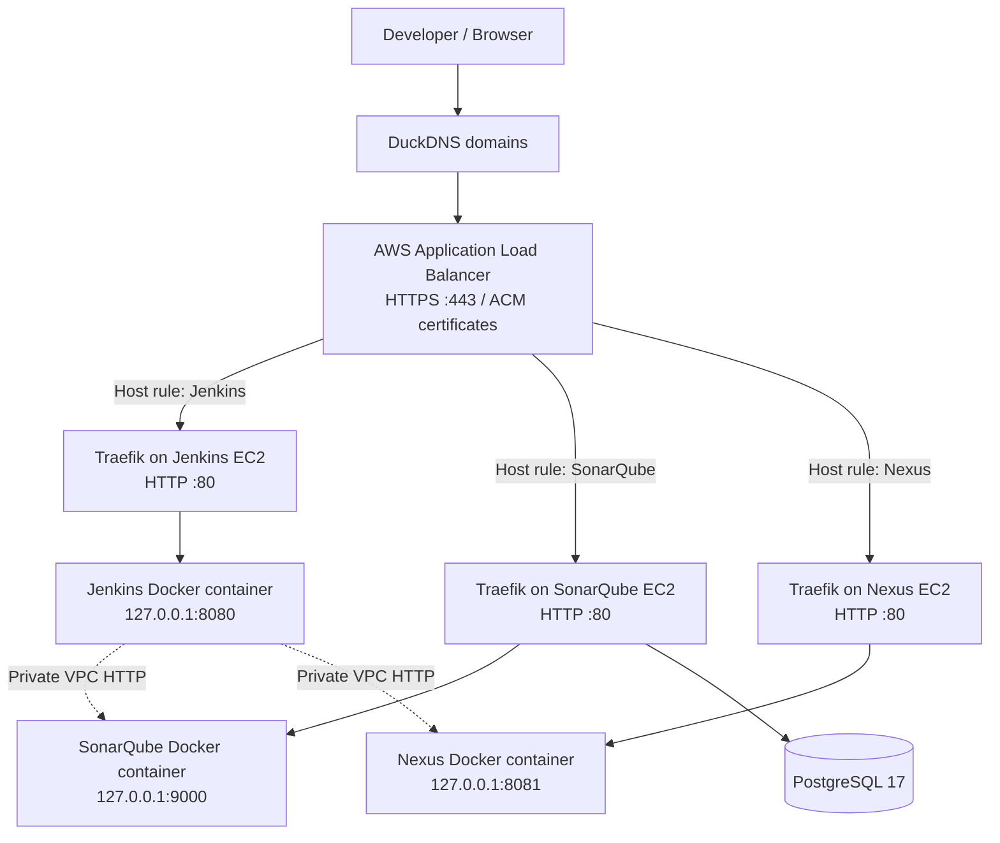
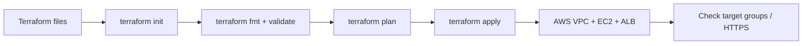
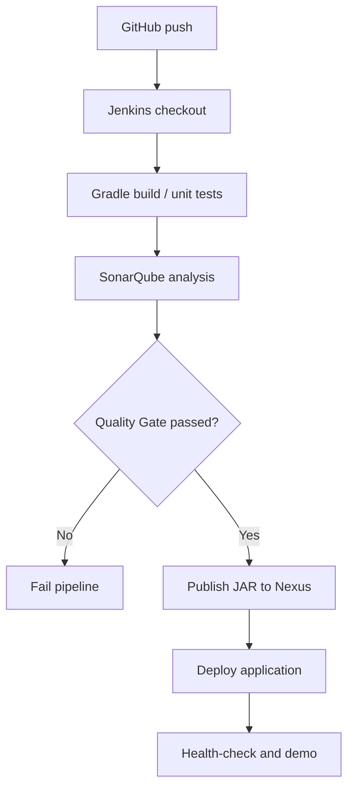

# DevOps Mini Project — AWS Infrastructure, Automation & CI/CD

> **Project status (27 November 2026):** Scope 1 infrastructure and Scope 2 server configuration have been implemented and tested. Scope 3 CI/CD connectivity has been verified; the complete build → quality gate → Nexus publish → deployment pipeline is **not yet demonstrated end-to-end**.

## 1. Project overview / គោលបំណង

This project demonstrates a practical DevOps workflow using **Terraform, Ansible, Docker Compose, Traefik, AWS Application Load Balancer (ALB), HTTPS, Jenkins, SonarQube, and Nexus Repository**.

គោលបំណង៖ ប្រើ Infrastructure as Code ដើម្បីបង្កើត AWS Resources, ប្រើ Configuration Management ដើម្បី Install និង Configure Services, ហើយភ្ជាប់ CI/CD Tools សម្រាប់ Build, Test, Code Quality និង Artifact Management។

### Three project scopes

| Scope | Topic | Goal | Current result |
|---|---|---|---|
| **Scope 1** | **Infrastructure Provisioning with Terraform** | Provision AWS networking, EC2, Security Groups, ALB and HTTPS routing | ✅ Implemented and verified |
| **Scope 2** | **Server Configuration with Ansible** | Configure Docker, Jenkins, SonarQube, Nexus, Traefik and security | ✅ Implemented and verified |
| **Scope 3** | **CI/CD Integration and Demo** | Integrate GitHub → Jenkins → SonarQube → Nexus → deploy | 🟡 Networking tested; full pipeline pending |

## 2. Architecture



**Important:** DuckDNS currently points to one resolved ALB public IP as a **temporary laboratory workaround**. ALB IP addresses can change. A DNS provider supporting a CNAME/ALIAS to the ALB hostname is the recommended stable solution.

### AWS inventory

| Host | Purpose | Private IP at last verification | EC2 instance ID |
|---|---|---|---|
| `devops-mini-jenkins` | CI/CD controller | `10.20.0.29` | `i-091cd8472549dceb4` |
| `devops-mini-sonarqube` | Static code analysis | `10.20.1.172` | `i-0bece7246f9d9d113` |
| `devops-mini-nexus` | Artifact repository | `10.20.0.107` | `i-0149579e1969217ba` |

- Region: `ap-southeast-1` (Singapore)
- VPC CIDR: `10.20.0.0/16`
- Deployment: 3 EC2 instances across 2 public subnets
- Instance type used: `m7i-flex.large`
- Volumes: Jenkins 40 GiB, SonarQube 40 GiB, Nexus 50 GiB
- ALB: `devops-mini-alb-692572589.ap-southeast-1.elb.amazonaws.com`

Public IPs of EC2 instances and ALB nodes are **not permanent**; do not hard-code them into new automation.

## 3. Repository structure / រចនាសម្ព័ន្ធ Files

The layout below documents the **known project directories and files** from the lab. Use `tree -a -I '.terraform|.git|tfplan'` to confirm additional filenames in your actual repository before committing documentation.

```text
devops-aws-mini-project/
├── README.md                         # Project overview, scopes and operations
├── terraform/                        # Scope 1: AWS infrastructure as code
│   ├── alb.tf                        # ALB, HTTP listener, target groups, host rules
│   ├── https.tf                      # ACM certificates, HTTPS listener/SNI rules
│   ├── terraform.tfvars              # Environment-specific Terraform values (review before commit)
│   └── ...                           # VPC, subnets, instances, SGs, providers, outputs
└── ansible/                          # Scope 2: configuration management
    ├── playbooks/
    │   └── traefik.yml               # Deploy and configure Traefik
    ├── group_vars/
    │   └── sonarqube/
    │       └── vault.yml             # Ansible Vault-encrypted values (never expose password)
    └── ...                           # Inventory, Docker, Jenkins, SonarQube, Nexus automation
```

### How the code works / ពន្យល់ពី Code

| Component | Responsibility / មុខងារ |
|---|---|
| Terraform provider and variables | Select AWS region, instance settings and trusted IP CIDRs |
| Terraform VPC/subnets/routes | Create the network and Internet access path for public EC2/ALB |
| Terraform EC2/key pair | Create 3 Linux hosts and configure SSH public-key access |
| Terraform Security Groups | Restrict SSH and public HTTPS; allow ALB → Traefik and private service connections |
| `terraform/alb.tf` | Create one ALB and 3 target groups; health-check `/ping`; route by `Host` header |
| `terraform/https.tf` | Attach imported ACM TLS certificates to HTTPS listener; route each HTTPS hostname to its target group |
| Ansible inventory | Define Jenkins, SonarQube and Nexus hosts so playbooks target the correct machines |
| Ansible Docker/service setup | Install Docker/Compose; run the right container stack on each machine |
| Ansible Vault | Encrypt sensitive SonarQube configuration values at rest in the Ansible repository |
| `ansible/playbooks/traefik.yml` | Configure Traefik on each host; expose HTTP :80 to ALB, forward to service bound to localhost |
| `acme.sh` (local machine) | Issue/renew Let's Encrypt certs via DuckDNS DNS-01; hooks can reimport certs into ACM |

Do not infer that `terraform.tfvars` or files in local secret directories are safe to publish: review all values and ignore sensitive files before `git push`.

---

## Scope 1 — AWS Infrastructure Provisioning (Terraform)

**Goal:** Automatically build the AWS foundation without manually creating each resource in the AWS Console.

**Implemented resources:** VPC, internet connectivity, public subnets in two Availability Zones, route associations, EC2 instances, SSH key pair, security groups, ALB, target groups, health checks, host-based HTTP/HTTPS routing, and imported ACM certificates.

### Workflow



### Main Terraform commands

```bash
cd ~/devops-aws-mini-project/terraform
terraform init
terraform fmt
terraform validate
terraform plan -out=tfplan
terraform apply tfplan
terraform state list
terraform output
```

**Why each command?**

- `init`: download providers and initialize the Terraform working directory.
- `fmt`: standardize `.tf` file formatting.
- `validate`: check Terraform syntax and configuration consistency.
- `plan`: review proposed changes before touching AWS.
- `apply`: create or update the actual resources.
- `state list`: show resources currently tracked in Terraform State.
- `output`: print useful Terraform output values if defined.

### Verification

```bash
aws sts get-caller-identity
aws ec2 describe-instances \
  --region ap-southeast-1 \
  --instance-ids \
  i-091cd8472549dceb4 \
  i-0bece7246f9d9d113 \
  i-0149579e1969217ba \
  --query 'Reservations[].Instances[].{ID:InstanceId,State:State.Name,PrivateIP:PrivateIpAddress}' \
  --output table
```

Terraform ALB target groups were verified **healthy**, and HTTPS tests with correct DNS hostnames and ALB routing returned `200` for all three services.

**Security note:** ALB HTTPS ingress was limited to approved `/32` source IPs during the lab. Keep this restriction for administrative UIs.

---

## Scope 2 — Automated Server Configuration (Ansible)

**Goal:** Configure each EC2 server consistently without repeated manual SSH setup.

### Server responsibilities

| Server | Installed/configured applications | Application endpoint behind Traefik |
|---|---|---|
| Jenkins | Docker Engine + Compose, Jenkins LTS with JDK 21, Traefik | `127.0.0.1:8080` |
| SonarQube | Docker Engine + Compose, SonarQube Community, PostgreSQL 17, Traefik | `127.0.0.1:9000` |
| Nexus | Docker Engine + Compose, Sonatype Nexus Repository, Traefik | `127.0.0.1:8081` |

The observed remote Compose files were:

```text
/opt/jenkins/compose.yml
/opt/sonarqube/compose.yml
/opt/sonarqube/.env
/opt/nexus/compose.yml
/opt/traefik/traefik.yml
/opt/traefik/dynamic.yml
```

### Why Ansible?

Ansible connects to remote hosts over SSH and applies desired server configuration through Playbooks. Using Inventory Groups lets the same project configure multiple distinct machines; Ansible Vault protects confidential configuration values.

### Useful commands

```bash
cd ~/devops-aws-mini-project/ansible
ansible all -m ping
ansible-playbook playbooks/traefik.yml --syntax-check --ask-vault-pass
ansible-playbook playbooks/traefik.yml --ask-vault-pass
```

If instances were stopped/started, first check **fresh public IPs** and update your Ansible inventory/SSH access as necessary. Ensure the inventory and Vault password are available before rerunning playbooks.

### Verify backends from Jenkins

```bash
ansible jenkins -b -m command \
  -a "curl -sS -o /dev/null -w '%{http_code}' http://10.20.1.172/"

ansible jenkins -b -m command \
  -a "curl -sS -o /dev/null -w '%{http_code}' http://10.20.0.107/"

ansible jenkins -b -m shell -a \
  'docker exec jenkins bash -c "curl -fsS --max-time 10 http://10.20.1.172/api/system/status"'
```

**Observed results:** SonarQube API returned `"status":"UP"`; Nexus returned `HTTP 200` from inside the Jenkins container. This confirms internal connectivity, **not** that CI/CD authentication or publishing already works.

---

## Scope 3 — Jenkins, SonarQube & Nexus CI/CD Integration

**Goal:** Automate the application delivery process from GitHub source to a deployed application.

### Planned pipeline



### Integration endpoints

| Integration | Private network endpoint | Notes |
|---|---|---|
| Jenkins → SonarQube | `http://10.20.1.172` | Tested reachable from Jenkins container |
| Jenkins → Nexus | `http://10.20.0.107` | Tested reachable from Jenkins container |
| SonarQube → Jenkins webhook | `http://10.20.0.29/sonarqube-webhook/` | Requires setup and end-to-end validation |
| Nexus Maven snapshots | `http://10.20.0.107/repository/maven-snapshots/` | Exists only after the repository is configured |

### Work remaining / ការងារនៅសល់

- [ ] Recover or reset Jenkins, SonarQube and Nexus administrator access securely.
- [ ] Install/verify Jenkins Git, Pipeline, SonarQube Scanner and Credentials Binding plugins.
- [ ] Configure SonarQube token and Jenkins SonarQube server entry.
- [ ] Configure SonarQube webhook and webhook secret; verify delivery.
- [ ] Create the Nexus Maven hosted repository and least-privilege publishing credentials.
- [ ] Select a Java 21 + Gradle Spring Boot demo application and add its Jenkinsfile.
- [ ] Execute build, tests, analysis and passing Quality Gate.
- [ ] Publish a real JAR artifact to Nexus, deploy it, and verify health checks.
- [ ] Capture evidence and record the final demo video.

> **Do not claim the complete CI/CD pipeline is finished yet.** The verified milestone so far is the private-network connection between Jenkins and the SonarQube/Nexus services.

---

## 4. Public endpoints and HTTPS

| Service | Lab URL |
|---|---|
| Jenkins | `https://devops-mini-jenkins.duckdns.org/login` |
| SonarQube | `https://devops-mini-sonar.duckdns.org/` |
| Nexus | `https://devops-mini-nexus.duckdns.org/` |

HTTPS is terminated by **AWS ALB**, using three imported Let's Encrypt certificates in **AWS Certificate Manager (ACM)**. ALB forwards HTTP traffic to Traefik on the matching EC2 instance; Traefik forwards it to the appropriate local container.

The three endpoints were verified returning HTTP `200` in the lab. URLs may be unavailable when EC2 instances are stopped, when source IPs are not allowed by the ALB security group, or if the DuckDNS-mapped ALB IP changes.

### Certificate lifecycle

1. `acme.sh` runs from the local Ubuntu machine via cron.
2. DNS-01 validation uses DuckDNS.
3. Renewed certificate files are installed into `~/.local/share/devops-mini-certs/`.
4. A renewal hook is configured to reimport each certificate into the **same ACM certificate ARN**.
5. ALB continues using the imported ACM certificate attachment.

**Operational risk:** acme.sh auto-renewal and successful ACM reimport are different tasks. Renewal automation depends on the local computer remaining online, AWS credentials remaining valid, permissions, DuckDNS access, and successful future hook execution. Monitor imported certificate expiry; the first future renewal-to-ACM cycle has not yet been observed in the shared lab results.

### Verify certificates / cron

```bash
crontab -l
~/.acme.sh/acme.sh --list
aws acm list-certificates --region ap-southeast-1 --certificate-statuses ISSUED
```

---

## 5. Starting and stopping the laboratory

### Stop the three EC2 instances

```bash
aws ec2 stop-instances --region ap-southeast-1 --instance-ids \
  i-091cd8472549dceb4 \
  i-0bece7246f9d9d113 \
  i-0149579e1969217ba

aws ec2 wait instance-stopped --region ap-southeast-1 --instance-ids \
  i-091cd8472549dceb4 \
  i-0bece7246f9d9d113 \
  i-0149579e1969217ba
```

### Start again

```bash
aws ec2 start-instances --region ap-southeast-1 --instance-ids \
  i-091cd8472549dceb4 \
  i-0bece7246f9d9d113 \
  i-0149579e1969217ba

aws ec2 wait instance-running --region ap-southeast-1 --instance-ids \
  i-091cd8472549dceb4 \
  i-0bece7246f9d9d113 \
  i-0149579e1969217ba
```

Stopping EC2 **does not stop all AWS charges**: ALB, EBS volumes, public IPv4 resources and other allocated services may continue accruing costs. **Do not run `terraform destroy`** unless you intend to remove resources, and have backed up important persistent data first.

After EC2 restart, inspect instance public IPs, SSH/inventory entries, running Docker containers and ALB target health before testing the application URLs.

## 6. Security, secrets and repository hygiene

- Never commit SSH private keys, DuckDNS tokens, AWS access keys, Jenkins credentials, certificate private keys, unencrypted secrets, Vault password files or Terraform state files.
- Check `terraform.tfvars` and all local `.env` files before publishing; they may contain sensitive data.
- Keep Ansible Vault values encrypted and the Vault password separate.
- Use narrowly scoped IAM and Nexus accounts; do not publish artifacts using an administrator account if a dedicated CI role is available.
- Keep the ALB administrative UIs accessible only from trusted source IPs.
- Protect EC2 volumes and back up Docker service data before destructive changes.

Suggested `.gitignore` entries (merge into the repository's actual `.gitignore`, do not overwrite existing rules):

```gitignore
# Terraform runtime/state
**/.terraform/
**/*.tfstate
**/*.tfstate.*
**/tfplan
**/crash.log
**/crash.*.log
**/override.tf
**/override.tf.json
**/*_override.tf
**/*_override.tf.json

# Sensitive local environment files
.env
.env.*
*.pem
*.key
*.p12
*.pfx
*.auto.tfvars
*.auto.tfvars.json
**/.vault_pass*
**/vault-password*

# Add terraform.tfvars if it contains secrets; use example vars in Git instead
# terraform/terraform.tfvars
```

Do not blindly ignore every `*.tfvars`: non-secret example variable files are useful to commit; use `terraform.tfvars.example` for a safe template.

## 7. Demo / submission outline

1. **Introduction:** project objective and 3 scopes.
2. **Scope 1:** show Terraform project, `terraform state list`, AWS EC2, VPC, security groups, ALB and healthy target groups.
3. **Scope 2:** show Ansible inventory/playbooks, Docker containers running, Traefik configuration and HTTPS endpoints.
4. **Scope 3:** show verified Jenkins connectivity to SonarQube and Nexus; after implementation, run the full Jenkins pipeline and demonstrate a published Nexus artifact and deployment.
5. **Security:** describe DNS limitation, ALB HTTPS, ACM, `acme.sh`, Ansible Vault and private internal networking.
6. **Conclusion:** compare intended scope to verified results, note pending tasks and explain EC2 stop/start cost considerations.

### Project summary for a presenter / Script ខ្លី

> Project នេះខ្ញុំបែងចែកជា 3 Scopes។ Scope 1 ខ្ញុំប្រើ Terraform ដើម្បីបង្កើត AWS Infrastructure ដូចជា VPC, EC2, Security Group និង Application Load Balancer។ Scope 2 ខ្ញុំប្រើ Ansible ដើម្បី Install Docker និង Deploy Jenkins, SonarQube, Nexus ជាមួយ Traefik Reverse Proxy។ ចំពោះ Scope 3 ខ្ញុំកំពុងភ្ជាប់ Jenkins Pipeline ជាមួយ SonarQube សម្រាប់ Code Quality និង Nexus សម្រាប់ផ្ទុក Artifacts។ បច្ចុប្បន្ន Internal Network រវាង Services ដំណើរការហើយ ប៉ុន្តែត្រូវ Test Full Pipeline បន្តទៀត។

---

## 8. Next improvements

- Move DuckDNS-to-ALB-IP workaround to stable CNAME/ALIAS-capable DNS.
- Run certificate renewal on an always-on controlled machine or managed automation and add expiration alerts.
- Finish the CI/CD pipeline, use Jenkins credentials correctly and confirm the SonarQube webhook.
- Make a repeatable service-health smoke test and collect final screenshots/video.
- Reconcile this README's file structure with `tree` output from the actual local repository.

**Stack:** AWS • Terraform • Ansible • Docker Compose • Traefik • Let's Encrypt / acme.sh • AWS ACM • Jenkins • SonarQube • PostgreSQL • Nexus Repository • DuckDNS
